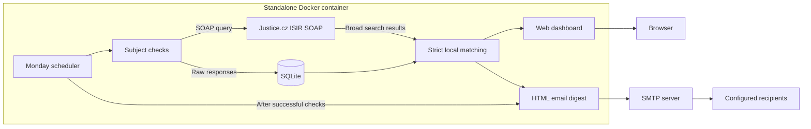

# ISIR Watch

**Czech insolvency monitoring with a web dashboard and scheduled email digests. One Docker container, ready for TrueNAS.**


ISIR Watch is a standalone web application for monitoring individuals and
companies in the Czech Insolvency Register (ISIR). Manage monitored subjects,
check their current insolvency proceedings, and receive scheduled email summaries.
Data is retrieved from the public Justice.cz SOAP service.


[Quick start](#quick-start) · [TrueNAS deployment](#github-container-registry-and-truenas) · [Scheduling](#manual-operations-and-scheduling) · [Backup and restore](#backup-and-restore) · [Configuration](.env.example)

The web interface and email templates are currently in Czech. This documentation is in English.

## How it works



The dashboard and email digest share the same matching logic. Raw responses are
retained for later reprocessing, while displayed counts reflect filtered matches.

## Features

- Monitor companies by Czech business identification number (IČO) and individuals by surname, first name, and date of birth.
- Check individual subjects through the web interface or all subjects through the CLI.
- Apply strict local filtering to reduce false matches between similar names.
- View the latest checks, matching proceedings, and service errors.
- Manage email recipients and send HTML digests.
- Run automatic Monday checks followed by an email summary.
- Deploy as a standalone Docker container or a TrueNAS custom app using Compose YAML.

## Architecture and storage

The application uses Python, FastAPI, and Jinja2 for the web interface, zeep for
SOAP communication, and SQLite for subjects, responses, and email recipients.
A single container runs the web application, database, and scheduler.
No external database or scheduling service is required.

By default, the SQLite database is stored **inside the container** at
`/data/isir-watch.db`. Restarting the same container preserves its data.
Removing or recreating the container, including during an image update, loses
that data unless external storage is configured. The Dockerfile does not declare
a `VOLUME`. Back up the database before replacing the container.

## Quick start

```sh
cp .env.example .env
# Configure SMTP and the sender address in .env.
docker compose build
docker compose up -d
docker compose logs -f
```

Open http://localhost:8081. To run without Compose:

```sh
docker build -t isir-watch .
docker run -d --name isir-watch --restart unless-stopped --env-file .env -p 8081:80 isir-watch
```

SMTP is required only when sending a digest to configured recipients.
Add subjects and recipients, run a manual check, and send a test digest.
Set `ISIR_SCHEDULER_ENABLED=false` to disable scheduling during setup.

The `.env` file contains credentials and must not be committed to Git.
Gmail SMTP requires an app password. The web interface has no authentication
and is intended for a trusted internal network.

## Manual operations and scheduling

```sh
docker compose exec app python -m app.check_all
docker compose exec app python -m app.mail_digest
```

Manual checks do not send a digest. Automatic checks run every Monday at 06:00
in the `Europe/Prague` time zone. The digest is sent only after all subjects
have been checked successfully. No systemd timers, cron, or APScheduler are needed.

The scheduler starts only through `python -m app.run`, using a single process
and container. Do not run multiple replicas against the same database.
Starting Uvicorn directly does not start the scheduler.

On its first start, the scheduler records the latest scheduled time without
sending a retrospective digest. After subsequent restarts, it catches up with
the most recent missed Monday run. It records the scheduled run before execution
to prevent duplicate emails after a crash. Failed runs are not retried
automatically; use the CLI commands to retry. Python zoneinfo and tzdata handle
CET/CEST transitions.

If a subject check fails, the batch continues and returns a nonzero exit code;
the automatic digest is skipped. A manually sent digest explicitly displays
stored check errors rather than presenting them as zero matches.

## Matching behavior

SOAP searches use broad criteria followed by strict local matching. Names are
normalized using Unicode NFC, whitespace trimming, and case normalization;
accents remain significant. Dates of birth and business identification numbers
are normalized before comparison.

For subjects identified by IČO, results without an IČO are conservatively
excluded; the stored company name is a display label. Queries reaching the
50-result limit are marked as potentially incomplete.

Raw SOAP responses are retained. The web interface and email digest use the
same filtering function and display the number of filtered matches.

## Backup and restore

Stop the container before copying the database to obtain a consistent backup.
For Compose deployments, replace the container name below with the name shown
by `docker compose ps`.

```sh
docker stop isir-watch
docker cp isir-watch:/data/isir-watch.db ./isir-watch.db
docker start isir-watch
```

Also back up `.env` and the deployment YAML. To restore, copy the database back
into an existing stopped container. The database file must be owned by UID 10001.

To preserve data when replacing the container, mount a volume or host directory
at `/data`. No application code changes are required. The mounted directory
must be writable by UID 10001.

## GitHub Container Registry and TrueNAS

The `.github/workflows/image.yml` workflow runs tests and builds the image.
Pushes to `main` publish `ghcr.io/<owner>/<repository>:latest`; tags matching
`v*` publish a corresponding version tag. Pull requests build the image without
publishing it. Make the GHCR package public to allow anonymous image pulls.

`deploy/truenas.yaml` provides Compose YAML for TrueNAS releases using Docker
Apps (24.10 and later). Replace the image placeholder with the published GHCR
image name, configure SMTP, and paste the YAML into **Apps → Install via YAML**.
No local build or `.env` file is required for this deployment.

See [TrueNAS: Installing Custom Apps](https://apps.truenas.com/managing-apps/installing-custom-apps/).
Back up the database before updating the image if external storage is not configured.

## Local development and tests

```sh
python -m venv .venv
# Activate the virtual environment.
pip install -r requirements.txt
python -m pytest -q
# Set ISIR_DB_PATH=data/isir-watch.db and PORT=8081 for local development.
python -m app.run
```

Unit tests do not require Justice.cz or an SMTP server. They cover strict
filtering, normalization, database operations, matching counts in the web
interface and digest, SMTP failures, and Monday scheduling including DST.

Run the read-only SOAP integration check with:

```sh
python -m scripts.soap_smoke
```

This uses the test IČO `00000000`, does not store results or send email, and
requires access to Justice.cz on port 8443.

## Project structure

```text
app/          Web application, SOAP client, SQLite repository, scheduler, and CLI
app/templates/ Server-rendered web pages and HTML email templates
app/static/   Web interface styles
deploy/       TrueNAS Compose YAML
scripts/      Read-only SOAP integration check
tests/        Filtering, database, web, email, and scheduler tests
.github/      Test and container image publishing workflow
```
