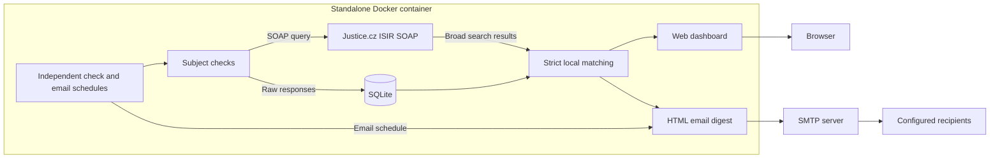

# ISIR Watch

**Czech insolvency monitoring with a web dashboard and scheduled email digests. One Docker container, ready for TrueNAS.**


ISIR Watch is a standalone web application for monitoring individuals and
companies in the Czech Insolvency Register (ISIR). Manage monitored subjects,
check their current insolvency proceedings, and receive scheduled email summaries with rolling change history.
Data is retrieved from the public Justice.cz SOAP service.


[Quick start](#quick-start) · [TrueNAS deployment](#github-container-registry-and-truenas) · [Scheduling](#manual-operations-and-scheduling) · [Backup and restore](#backup-and-restore) · [Configuration](.env.example)

The web interface and email templates are currently in Czech. This documentation is in English.

## How it works



The dashboard and email digest share the same matching logic. Raw responses are
retained for later reprocessing, while displayed counts reflect filtered matches.

## Features

- Monitor companies by Czech business identification number (IČO) and individuals by birth number (rodné číslo), or surname, first name, and date of birth.
- Check individual subjects through the web interface or all subjects through the CLI.
- Apply strict local filtering to reduce false matches between similar names.
- View the latest checks, matching proceedings, and service errors.
- Manage email recipients and send HTML digests.
- Configure independent daily, weekly, or monthly schedules for checks and email.
- Review detected changes over rolling 7, 30, and 60-day windows.
- Recover accidentally deleted subjects and their history from the trash.
- Deploy as a standalone Docker container or a TrueNAS custom app using Compose YAML.

## Architecture and storage

The application uses Python, FastAPI, and Jinja2 for the web interface, zeep for
SOAP communication, and SQLite for subjects, responses, and email recipients.
A single container runs the web application, database, and scheduler.
No external database or scheduling service is required.

By default, the SQLite database is stored **inside the container** at
`/data/isir-watch.db`. Restarting the same container preserves its data.
Removing or recreating the container, including during an image update, loses
that data unless external storage is configured. The Dockerfile does not declare
a `VOLUME`. Back up the database before replacing the container.

## Quick start

```sh
cp .env.example .env
# Configure SMTP and the sender address in .env.
docker compose build
docker compose up -d
docker compose logs -f
```

Open http://localhost:8081. To run without Compose:

```sh
docker build -t isir-watch .
docker run -d --name isir-watch --restart unless-stopped --env-file .env -p 8081:80 isir-watch
```

SMTP is required only when sending a digest to configured recipients.
Add subjects and recipients, run a manual check, and send a test digest.
Set `ISIR_SCHEDULER_ENABLED=false` to initialize both schedules as disabled during setup.
After initialization, enable or disable each schedule in the web interface; the database settings take precedence.

The `.env` file contains credentials and must not be committed to Git.
Gmail SMTP requires an app password. The web interface has no authentication
and is intended for a trusted internal network.

## Manual operations and scheduling

```sh
docker compose exec app python -m app.check_all
docker compose exec app python -m app.mail_digest
```

Manual checks do not send a digest. The web interface offers separate check and
email schedules: daily, selected weekdays, or a day of the month, each with its
own local time and enabled switch. Missing month days (such as February 31) use
the last day of that month. Defaults are daily checks at 06:00 and Monday email
at 07:00, in the configured `TZ` (Europe/Prague by default).

The environment variable `ISIR_SCHEDULER_ENABLED` seeds the initial enabled state
only. Existing saved web settings take precedence. You can enable schedules in
the web interface even when the deployment YAML still contains `false`.
The database stores schedules, execution status, and the last attempted slots.
Saving a schedule starts it from its next occurrence without a retrospective run.
After a restart, the scheduler catches up with the latest missed occurrence.

A single scheduler starts through `python -m app.run`; do not run multiple replicas
against the same database. Direct Uvicorn does not start the scheduler. If both
jobs are due together, checks finish first. Failed checks in that batch suppress
the simultaneous email. Independently scheduled email reports stored errors
explicitly. Failed or interrupted scheduled attempts are not automatically retried;
use the web buttons or CLI to retry.

The optional **send only when there are new changes** setting skips scheduled
email unless active subjects have change events newer than the last successfully
sent digest. The first complete check establishes a baseline, not a change event.
A manually sent digest bypasses this option and also advances the delivery marker
on success. No recipients or an SMTP failure does not advance the marker.

## Change history

Each subject has rolling **7, 30, and 60-day** summaries with dated before/after
values. The web interface and HTML email use the same history. A change remains
visible throughout its window, even if an earlier email was missed. All detected
transitions are retained, including A → B → A.

History tracks new proceedings, proceedings no longer returned by the current
search, and changes to status, name, identifiers, birth date, and address. A missing
proceeding is described as absent from current results, not as legally closed.
The event timestamp is when the application detected the change, not necessarily
when it happened in the register. The first reliable check is a baseline. Failed
checks and potentially truncated responses cannot create disappearance events.
Results without a stable case identifier are excluded from historical comparisons.

Available stored successful responses are backfilled once, in result order, using
the subject's current identity filter. Previously edited identities cannot be
reconstructed exactly from old raw responses. Changing an identifier or restoring
a subject starts a new comparison baseline; recorded events remain intact.

## Trash and recovery

Removing a subject moves it to the trash, retaining its ID, checks, and change
history. Trashed subjects are excluded from checks and email digests. Restore a
subject from **Trash** to resume monitoring. The trash never empties automatically.
Permanent deletion is available only for trashed subjects and requires typing
`SMAZAT`; it removes the subject and all associated results and change events.
The trash protects against accidental clicks and does not replace a database backup.

## Matching behavior

SOAP searches use broad criteria followed by strict local matching. Names are
normalized using Unicode NFC, whitespace trimming, and case normalization;
accents remain significant. Dates of birth and business identification numbers
are normalized before comparison.

Birth numbers accept 9 or 10 digits, with an optional slash after the first six
digits. They are stored as text without the slash. A birth-number search sends
only `rc` to SOAP and requires an exact local match; missing birth numbers are
excluded. Names and dates entered alongside a birth number are descriptive.
Existing individuals can have their birth number added or cleared in place.

For subjects identified by IČO, results without an IČO are conservatively
excluded; the stored company name is a display label. Queries reaching the
50-result limit are marked as potentially incomplete.

Raw SOAP responses are retained. The web interface and email digest use the
same filtering function and display the number of filtered matches.

## Database upgrades

The watch-history upgrade adds soft-delete metadata, comparison snapshots, and
change-event tables without removing subjects, results, recipients, or settings.
Before its schema migration, it saves a SQLite backup next to the database as
`isir-watch.db.pre-watch-v2.db`. Keep the same `/data` mount during deployment.
Historical responses are backfilled idempotently at startup; a large history may
make the first start take longer.


On startup, existing databases are upgraded automatically by adding the `rc`
column to `subjects`. Subjects, their IDs, stored results, recipients, and scheduler
settings are preserved. Before this migration, a SQLite backup is saved next to
the database as `isir-watch.db.pre-rc.db` (if it does not already exist).
Keep the same `/data` mount when updating the container image.
After adding a birth number to an existing subject, run a new check to refresh
results using the new identifier.

## Backup and restore

Stop the container before copying the database to obtain a consistent backup.
For Compose deployments, replace the container name below with the name shown
by `docker compose ps`.

```sh
docker stop isir-watch
docker cp isir-watch:/data/isir-watch.db ./isir-watch.db
docker start isir-watch
```

Also back up `.env` and the deployment YAML. To restore, copy the database back
into an existing stopped container. The database file must be owned by UID 10001.

To preserve data when replacing the container, mount a volume or host directory
at `/data`. No application code changes are required. The mounted directory
must be writable by UID 10001.

## GitHub Container Registry and TrueNAS

The `.github/workflows/image.yml` workflow runs tests and builds the image.
Pushes to `main` publish `ghcr.io/<owner>/<repository>:latest`; tags matching
`v*` publish a corresponding version tag. Pull requests build the image without
publishing it. You can also start a publish run from **Actions → Publish container image → Run workflow**. After a successful publish, the job summary shows the exact commit image tag to use in `deploy/truenas.yaml`. Make the GHCR package public to allow anonymous image pulls.

`deploy/truenas.yaml` provides Compose YAML for TrueNAS releases using Docker
Apps (24.10 and later). Replace the image placeholder with the published GHCR
image name, configure SMTP, and paste the YAML into **Apps → Install via YAML**.
No local build or `.env` file is required for this deployment.

See [TrueNAS: Installing Custom Apps](https://apps.truenas.com/managing-apps/installing-custom-apps/).
Back up the database before updating the image if external storage is not configured.

## Local development and tests

```sh
python -m venv .venv
# Activate the virtual environment.
pip install -r requirements.txt
python -m pytest -q
# Set ISIR_DB_PATH=data/isir-watch.db and PORT=8081 for local development.
python -m app.run
```

Unit tests do not require Justice.cz or an SMTP server. They cover strict
filtering, normalization, database operations, matching counts in the web
interface and digest, SMTP failures, and Monday scheduling including DST.

Run the read-only SOAP integration check with:

```sh
python -m scripts.soap_smoke
```

This uses the test IČO `00000000`, does not store results or send email, and
requires access to Justice.cz on port 8443.

## Project structure

```text
app/          Web application, SOAP client, SQLite repository, scheduler, change history, and CLI
app/templates/ Server-rendered web pages and HTML email templates
app/static/   Web interface styles
deploy/       TrueNAS Compose YAML
scripts/      Read-only SOAP integration check
tests/        Filtering, database, web, email, and scheduler tests
.github/      Test and container image publishing workflow
```
